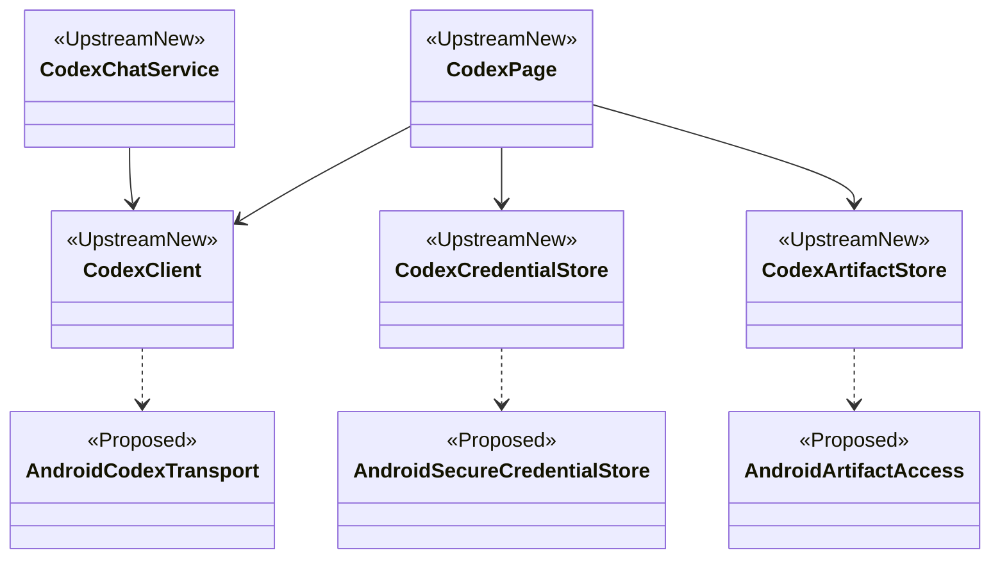
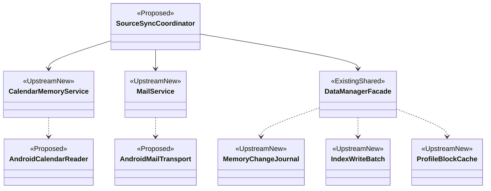

# coevomind-app 分支差异与迁移计划增量

核查日期：2026-11-03。本文覆盖旧计划冲突项，保留既有D/F/P编号和完成证据；新增功能均为Android待迁移，不能因上游存在就标为已完成。

## 1. 版本与核查边界

- 目标：[coevomind-app 固定提交](https://github.com/doulujiyao12/mobiinfra-oh/tree/4e86f6250c7739d0ea922e2379eeedad2d35d450)。该提交修复缺失本地模型时跳到下载设置的定位。
- Android构建锁仍为 `cd69b68bf16b9ed352be5073939eb24d042de583`，本轮不升级输入锁。
- GitHub compare返回 diverged：目标侧25个提交、旧锁侧8个独有提交，共同祖先 `182d2ca65d57e51aa614f2b2ab6672a1030a8ae5`。这是分叉，不是简单追加25个提交。
- compare文件列表用于发现变化，不是两个端点完整差异证明；部分统计为0不能解释为文件为空。锁升级前必须比较两端文件并审计旧侧8个提交。
- 本轮实际阅读导航、Codex页面/客户端、日历服务、邮件服务、手机微信采集、隐私代码、汇总/首页入口及增量同步/聊天委托文档。未运行上游构建、测试或服务；大型索引算法、完整桌面桥和原生模块仍需逐项代码审计。
- Git直连失败，改由已连接GitHub工具读取。未克隆私有状态、配置或凭据，未修改上游。早期读取使用分支名，随后确认固定提交并读取页面；正式锁升级时须对所有输入重新按固定SHA校验。

## 2. 新增用户功能（接续D30）

| 编号 | 用户功能与源码事实 | 拟迁移代码及支持 | 出口验收 |
| --- | --- | --- | --- |
| D31 Codex远程工作台 | CodexPage：保存多个连接、扫码/文件配对、电脑历史、工作目录、模型/思考强度、审批/文件访问设置、任务停止、共享会话/手机副本、附件与交付文件 | 复用pages/codex业务；Android扫码/文件选择、Keystore凭据、HTTP证书校验、文件打开/另存为；电脑bridge/codex独立部署 | 配对撤销、权限审批、断线恢复、不重复提交、文件校验、共享与副本会话不混淆；断开连接不宣称停止远端 |
| D32 聊天委托Codex | CodexChatService/Store/RunCard；云端工具run_codex_task，选择电脑及目录，独立会话、按run_id续改、审批和按轮交付 | 在SharedAgent白名单明确接入，保持原query_events边界；任务恢复记录和附件引用；不向模型提供凭据/文件二进制 | 初次委托、续改范围、用户问题回答、重启同步；停止只有远端确认后才完成；纯本地及旧PC聊天不默认获得工具 |
| D33 日历分析及一周安排 | CalendarMemoryService/Policy/Store、CalendarMemoryPanel/WeekDialog：选择来源、读取实例、重复日程、完成标记、是否纳入画像 | 拟AndroidCalendarReader使用CalendarContract只读访问；复用快照/实例/来源规则；独立系统授权 | 全天/时区/重复例外、日程修改删除、权限撤回、部分异常；安排不能记成已完成行为，失败保留旧数据但禁止冒充新结果 |
| D34 邮箱分析与今日关注 | MailService/Store/Analysis/ImapClient：近三天读取、独立AI筛选开关、今日提醒、筛选失败保留结果 | 拟AndroidMailTransport及安全凭据适配；复用IMAP/MIME契约与筛选规则；不是HTTP邮箱API替换 | UIDVALIDITY/账号隔离、编码/长正文、部分读取、AI失败重试、跨日；邮件不进入个人画像，未开AI时仅本机展示 |
| D35 来源管理与增量自动更新 | 新增采集源入口；24小时来源检查、失败来源重试、任务批次后分析、Debug完整检查记忆数据 | 复用MemoryChangeJournal、IndexWriteBatch、ProfileBlockCache等并审计；拟SourceSyncCoordinator统一互斥生命周期 | 无变化不重复分析、同步中写入不丢版本、删除撤回证据、发布中断恢复、旧索引升级、按源失败重试 |

D31附件页面显示最多6项、每项8MiB；D32聊天工具文档限制当前消息图片最多6张/每张8MB。两个入口必须分别验证协议与大小单位，不能因远程工作台支持文件就扩大聊天工具的任意文件访问范围。

## 3. 既有领域必须修订的部分

| 领域 | 变化 | 计划修订 |
| --- | --- | --- |
| D01 | MainTabConfig变为首页/汇总/聊天/Codex/任务/我的；Task=4、Mine=5 | 更新导航稳定标识、持久化索引、提醒跳转、返回栈、手册；不可只增加按钮 |
| D02/D26/D29 | PrivacyConsent转为AppGalleryKit平台签署查询，前台请求走AppRequests；原独立弹窗删除 | Android保留当前保护直到完成授权语义设计；区分前台服务使用、自动来源处理、日历权限、邮件AI和外部记忆分享，不能机械移除授权守卫 |
| D03–D05/D07 | 首页日历/今日邮件入口、提醒翻页；汇总增加来源管理、日历/邮箱入口 | 在既有画像/推荐之外接入独立来源视图，邮件不混入画像；关怀存储变更需补读HomeComfortConcernStore |
| D08/D12/D16 | 变更日志、事实去重、分层画像缓存、证据短ID、差量索引与发布恢复 | 优先迁移写入端的变更登记，再迁移读取/索引；不能只替换IndexService造成写入漏记 |
| D09/D19 | PhoneWechatAutoSummaryClient + WechatUiParser，手机直接HDC采集 | 将旧“只依赖PC”拆成手机与PC两条；Android需重新实现设备观察/控制，不复用Harmony UI树假设；保留coverage_complete和stop_reason |
| D21/D23 | 整批任务保存后触发一次增量分析；停止不启动分析，部分失败处理已保存结果 | 批次完成与分析完成分开；等待既有同步结束再检查变更，不重跑采集 |
| D25/D26 | 本地模型缺失后的设置下载定位修复 | 一次性滚动目标、正常设置仍从顶部进入、退出取消迟到回调 |
| D20/D28 | 新增bridge/codex与pc-companion桌面发行/连接管理 | 与原PC/HDC/Python链分开编号和验收；桌面伴侣不等于旧微信采集服务 |

隐私说明有证据冲突：incremental-memory-sync文档仍描述系统同意影响自动分析，而当前PrivacyConsent代码明确仅守卫外部个人记忆分享。U00必须追踪Index自动更新与AppRequests实际调用，不以旧文档直接决定Android授权行为。

## 4. 新模块类关系规划

下图UpstreamNew表示新分支有源码、Android尚未接入；Proposed为Android拟新增对象，箭头是目标调用链，非当前运行事实。

CodexClient的Harmony RemoteCommunicationKit传输须替换；保留禁重定向、连接代次隔离、取消、压缩回退及只重试幂等读取。任务、配对、上传、停止、审批遇到不明结果不能自动重发。Android传输/凭据/文件能力放android-capabilities，桥注册在PlatformBridge，共享页面仍在shared-frontend维护。

SourceSyncCoordinator是拟定职责名，不要求先抽取大类。先适配上游已有互斥流程。邮件结果走独立MailStore；日历快照与聊天/日志可进入个人记忆。自动更新是前台到期检查，不据此承诺Android后台定时执行。关闭自动更新不影响手动重试；本轮已经开始的来源结束后不再派发下一来源。

## 5. 对原W00–W08的增量工作包

| 编号 | 依赖与归属 | 交付及验收 |
| --- | --- | --- |
| U00 分叉兼容审计 | W00前置；立即开展 | 固定SHA两端逐文件差异、旧侧8提交保留/替代清单、平台授权决策、全部准备脚本补丁命中检查；通过后另开锁升级阶段 |
| U01 增量记忆基础 | U00；扩展W01/D08 | 变更日志写入口、缓存/证据、差量索引、prepared发布恢复；模拟故障/旧数据迁移/差量与完整重建一致性，再真机质量与性能 |
| U02 日历来源 | U01；扩展W01/D33 | Android只读适配、源选择、重复实例、一周安排、撤权；真实设备验收 |
| U03 邮箱来源 | U00；扩展W01/D34 | 安全凭据、IMAP读取与独立AI筛选、今日提醒；测试邮箱和真实服务验收，禁止使用私人邮箱作默认测试数据 |
| U04 Codex工作台 | U00；扩展W04/D31 | 六入口、配对、连接器协议、审批/恢复、产物下载与导出；桌面版本能力协商与真实端到端 |
| U05 聊天Codex委托 | U04；扩展W03/D32 | 工具白名单、用户确认、run_id续改约束、按轮结果、远端取消和重启恢复；未知状态只同步不重发 |
| U06 手机微信与批次同步 | W02/W03 + U01；扩展W04/D09 | UI观察适配、联系人唯一匹配、时间边界/部分覆盖、取消检查点；保存后统一分析，停止不自动分析 |

执行顺序修订：U00先行；既有真实聊天/图库验收继续。U01作为新增数据源与结果回流基础，U02/U03接续；GUI W02/W03后接U06；PC/Python W04同时纳入U04，之后U05；再W05身份替代、W06本地推理、W07整体验收。W08会议仍最后，新增范围不能绕过发布及数据迁移验证。

## 6. 来源与本轮验证

所有路径相对固定提交根：

- `entry/src/main/ets/pages/main/MainTabConfig.ets`：六入口。
- `entry/src/main/ets/pages/codex/{CodexPage,CodexClient}.ets`、`docs/codex-chat-tool.md`：远程工作台、协议边界和聊天委托。
- `entry/src/main/ets/utils/calendar/CalendarMemoryService.ets`：权限、重复实例、失败保留与撤权处理。
- `entry/src/main/ets/utils/mail/MailService.ets`：近三天、独立AI、检查点及失败范围。
- `entry/src/main/ets/utils/wechat/PhoneWechatAutoSummaryClient.ets`：手机采集、部分覆盖和取消保存。
- `entry/src/main/ets/utils/PrivacyConsent.ets`、`docs/incremental-memory-sync.md`：隐私变化与待核冲突、增量设计。
- `entry/src/main/ets/pages/{home/HomePage,collection/CollectionPage}.ets`：新来源入口与展示。

本轮仅更新规划，不把上游文档的测试描述算作本仓库测试通过，不更新Android功能完成计数。检查文档结构/本地链接及git diff --check；未渲染Mermaid，未执行Gradle、上游测试、服务或设备验收。
