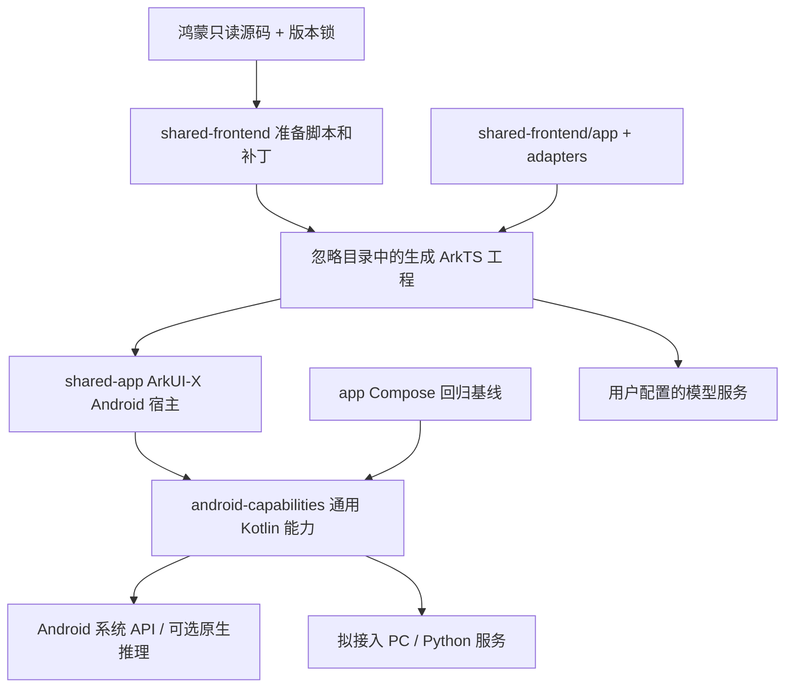
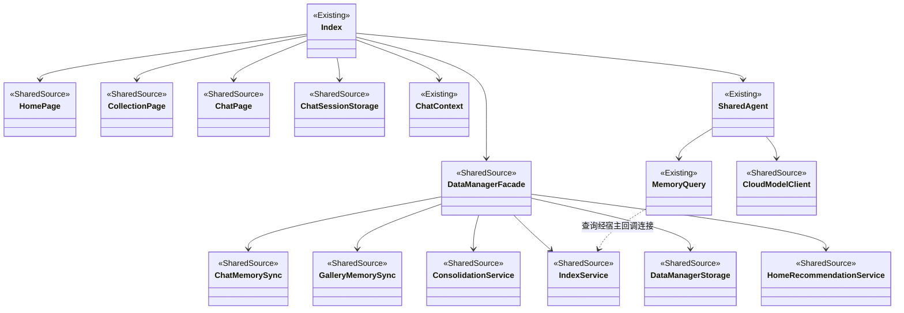
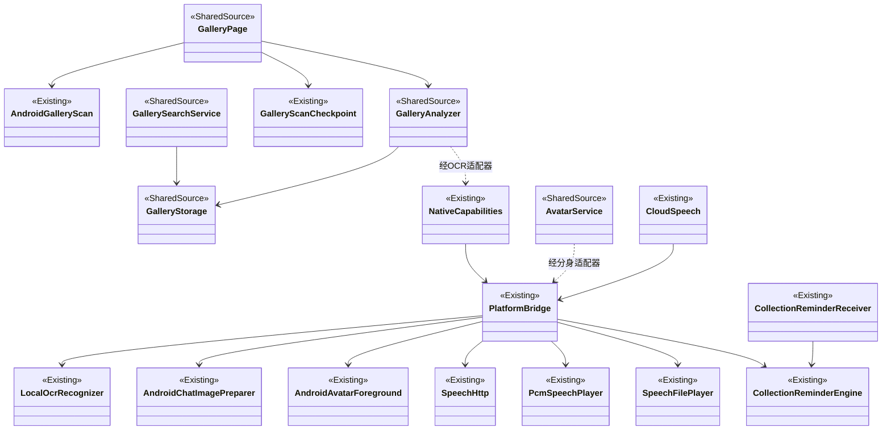
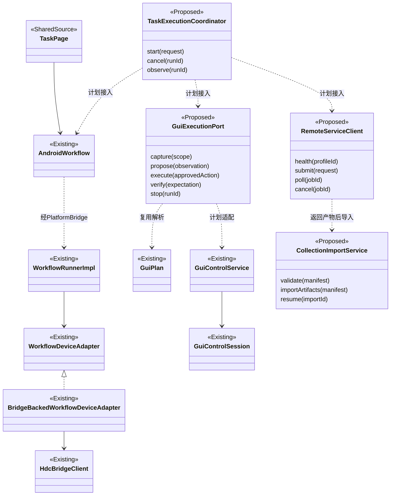
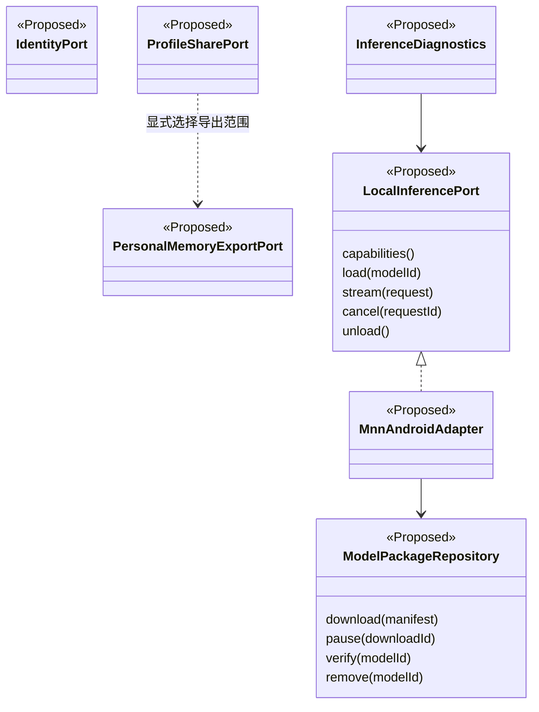

# ClawMate 全功能迁移代码规划与类关系指南

版本：2026-11-03。用途：后续迁移的任务拆分、代码归属、接口设计和验收依据。

最新目标增量：`coevomind-app@4e86f6250c7739d0ea922e2379eeedad2d35d450`，详见[分支差异与新增工作包](COEVOMIND_BRANCH_PLAN.md)。下文 D01–D30 的状态仍描述旧锁定源码的 Android 集成；新目标扩展为 D01–D35，以增量文档的覆盖规则为准。新分支与旧锁分叉，不能直接覆盖源码准备清单。

## 1. 使用方式与证据边界

- 当前构建输入仍锁定鸿蒙提交 `cd69b68bf16b9ed352be5073939eb24d042de583`；输入清单见 [upstream-lock.json](../shared-frontend/upstream-lock.json)。产品规划已扩展至上述新分支；原生、外部服务和会议仍需逐模块补充核查。
- 当前迁移状态以 [MIGRATION_BACKLOG.md](../MIGRATION_BACKLOG.md) 和 [MIGRATION_STATUS.md](../MIGRATION_STATUS.md) 的实际证据为准。本文件定义目标结构，不替代完成记录。
- 图中 `Existing` 表示当前目标源码中的类/组件；`SharedSource` 表示从鸿蒙准备的共享业务；`Proposed` 表示拟新增逻辑接口，尚未实现。箭头表示调用或数据依赖，不表示继承；只有实现箭头才表示接口实现。
- 接口中的方法为职责设计，不是对现有 API 签名的声明。实际接入前必须检查当前签名与上游契约。
- 不为符合图而重写现有模块，不一次性创建空类。新增接口随具体功能阶段落地；能扩展现有类就不增加抽象层。
- 保留 Compose `app/` 回归基线；不改变正式 applicationId，不自动搬迁旧私有数据。会议代码保留，新增会议工作和专项测试最后开展。

## 2. 工程与依赖边界

| 位置 | 负责什么 | 不应放什么 |
| --- | --- | --- |
| `shared-frontend/app/Index.ets` | 页面组装、状态衔接、现有业务入口连接 | 新增庞大设备控制实现、原生推理细节 |
| `shared-frontend/adapters/platform/` | ArkTS 平台契约、请求编排、桥接数据解析 | Android 系统 API、未配置时的假成功 |
| `shared-frontend/adapters/pages/` | 平台特有页面或明确能力边界 | 重新复制整套共享产品页面 |
| `shared-frontend/*-source.mjs`、`prepare.mjs` 等 | 可审查的上游转换与覆盖规则 | 修改忽略目录生成文件作为正式修复 |
| `shared-app/.../PlatformBridge.kt` | ArkUI-X 调用注册、宿主生命周期、权限和 UI 线程衔接 | 复制工作流引擎、持久化业务规则 |
| `android-capabilities/src/main/java/` | OCR、语音、图片、提醒、GUI、工作流及未来原生/远端适配 | 依赖 `app` 或 `shared-app` 的实现类 |
| `tests/`、模块测试源集 | 契约、解析、存储、状态机及设备验证 | 把协议夹具通过标为真实服务通过 |

注意：通用库内部分包仍名为 `com.clawmate.app.*`，归属按 Gradle 模块判断，不为包名进行无关重构。共享 ArkTS 业务文件由锁定输入生成，应修改准备规则或适配源码，不能直接维护生成副本。

## 3. 产品功能覆盖矩阵

状态：**集成**=有目标实现/连接，仍可能待验收；**部分**=仅部分链路；**待补**=尚未完成；**延后**=保留已有代码并安排最后阶段。

| ID / 用户功能 | 共享来源或现有入口 | Android 支持与拟补项 | 当前边界 / 验收重点 |
| --- | --- | --- | --- |
| D01 首次引导、导航、主题 | FirstLaunchOnboarding、MainTabConfig、Index | MainNavigation、SharedActivity | 旧五入口集成；新六入口含Codex待接入，任务/我的索引迁移须验证 |
| D02 账号、隐私、撤回 | PrivacyConsent、AiServiceAccess、HuaweiAccountCard | SettingsStore；拟 IdentityPort | 隐私集成；华为账号替代待补，不把自配服务授权称作登录 |
| D03 今日概览、画像 | HomePage、DataManagerFacade | 复用共享画像与索引 | 集成；真实来源、空态、更新一致性 |
| D04 推荐与任务建议 | HomeRecommendationService、HomeTaskSuggestion | SharedAgent；拟 TaskExecutionCoordinator | 建议集成，GUI 执行部分；来源与过期规则、任务结果 |
| D05 情绪关怀、陪伴 | HomeEmotionalSupport、HomeComfortChatStore | 现有 CloudModelClient | 集成；真实质量、取消和话题历史 |
| D06 数字分身与历史 | AvatarService、AvatarStorage、SeedreamAvatarProvider | AndroidAvatar、AndroidAvatarForeground、ChatAvatar | 集成；照片参考/分割/语音动画与多厂商质量待验 |
| D07 足迹、分组、详情 | CollectionPage、CollectionGroupDetailPage | DataManagerFacade、IndexService | 集成；多源记录、分页、来源与失效图片 |
| D08 同步、整理、长期记忆 | ChatMemorySync、GalleryMemorySync、ConsolidationService | MemorySyncPage、MemoryQuery | 集成；多源失败恢复、幂等、索引一致性 |
| D09 微信自动汇总 | WechatAutoSummaryClient、新增PhoneWechatAutoSummaryClient/WechatUiParser | 拟 RemoteCollectionClient、手机采集设备适配、CollectionImportService | PC与手机两路径待补；部分覆盖、取消保存、原始产物落盘 |
| D10 图片输入与分析 | GalleryPage、GalleryAnalyzer、GalleryOcrService | AndroidGalleryScan、LocalOcrRecognizer | 集成；真实选图→分析→保存未完成验收 |
| D11 图库批次管理 | GalleryWorkQueue、扫描会话 | GalleryScanCheckpoint、AndroidGalleryScan | 显式选图集成；全图库/HDC 待补，恢复与副本清理待验 |
| D12 检索、问答、月度洞察 | GallerySearchService、GalleryMonthlyInsights | 共享模型和向量服务配置 | 集成；真实检索质量、引用、缓存失效 |
| D13 照片地点与地图 | GalleryExifUtils、GalleryReverseGeocoder | 图片元数据与用户地图配置 | 需逐链验收；保留真实拍摄日与导入日语义差异 |
| D14 文本聊天、会话管理 | ChatPage、ChatSessionStorage | Index、SharedAgent | 集成；流式、取消、重命名/置顶/删除、重载 |
| D15 图片聊天、复制/Markdown | ChatAttachmentPolicy、ChatMessageList | ChatImages、AndroidChatImagePreparer | 集成；相机实拍、视觉模型、格式/无障碍待验 |
| D16 长上下文 | ChatContextBudget、ChatContext | 共享摘要与存储 | 集成；真实摘要质量、文件/索引一致性；字符估算非分词器 |
| D17 语音输入、朗读、重播 | ChatPage 语音控件 | CloudSpeech、ASR/TTS、PcmSpeechPlayer、SpeechFilePlayer | 集成；真人 ASR、MiMO 服务质量、来电/销毁待验 |
| D18 对话式 Agent | 原 ChatReactAgent/AgentLoopRunner 调用链 | SharedAgent；拟 TaskExecutionCoordinator | 当前仅有界 query_events；动作工具与完整执行待补 |
| D19 手机自动操作 | 原 PhoneHdcWorkflowBridge/SelfHdc 接入 | GuiPlan、GuiControlService/Session | 部分；单设备手动夹具通过，模型循环/业务验证待补 |
| D20 PC 控制 | 原 PcServerMonitor/AgentRouterServer 接入 | 既有 HdcBridgeClient；拟 RemoteServiceClient | 待补共享产品链；连接、执行、取消及结果 |
| D21 任务浏览与执行 | TaskPage、WorkflowStorage | AndroidWorkflow、WorkflowRunnerImpl | 本机有界执行集成；GUI、远端任务待补 |
| D22 图编辑、JSON、控制流 | TaskPage、WorkflowTypes | WorkflowJsonParser/EditValidator、WorkflowVariableResolver | 集成；复杂配置、完整 Schema、失败策略待验 |
| D23 工作流文件与结果管理 | WorkflowFileViewer、WorkflowStorage | AndroidWorkflow、DailyLogWorkspace | 集成；删除引用、结果回流与中断恢复 |
| D24 采集提醒 | CollectionReminderPanel/Policy | CollectionReminderEngine/Receiver | 集成；Doze、重启/时区和多厂商待验；通知不等于自动执行 |
| D25 本地模型下载与推理 | 原 Index 下载/加载调用、ModelDownloadConfig | 拟 ModelPackageRepository、LocalInferencePort | 待补；模型文件、MNN/C++、CPU/可选加速 |
| D26 服务配置与连通性 | SettingsCenterPage、CloudModelClient | SettingsStore、现有 HTTP/桥接 | 集成；字段隔离、错误、密钥脱敏及真实服务验收 |
| D27 文件清理与诊断 | LogView、OpTest、ProfileTest 等适配 | NativeCapabilities；拟 InferenceDiagnostics | 部分；当前受限原生诊断不可计完成 |
| D28 桌面端下载 | DesktopCompanionPage | 配置链接、浏览器打开 | 集成入口；下载成功不代表服务就绪 |
| D29 画像分享/匹配、小艺记忆 | 原 ProfileKnockShareService、PersonalMemoryAccess | 拟 ProfileSharePort、PersonalMemoryExportPort | 待补；分享传输、系统接入及 Android 替代须单独决策 |
| D30 会议/音频笔记 | 现有 MeetingPage、MeetingApi | MeetingBridge 与既有 SDK | 延后；完整上游范围待核，不由页面反推已完成 |

上述原类名只表示参考源码或调用点存在，不保证每个底层实现已包含在本地快照中。

## 4. 类关系：应用、个人数据和聊天

| 核心对象 | 应负责的契约 | 后续禁止混入的职责 |
| --- | --- | --- |
| DataManagerFacade | 同步入口、索引/画像/分组视图、来源关联 | 设备手势和 PC 连接 |
| ConsolidationService | 原始记录到结构化事件、处理标识 | 页面状态与权限申请 |
| IndexService | 有界事件查询、稳定来源 ID | 任意文件读取、无限量回传模型 |
| ChatSessionStorage | 会话、消息、摘要和附件引用持久化 | 云请求、系统音频播放 |
| ChatContext | 预算、摘要编排、取消后丢弃迟到结果 | 擅自删除磁盘原始历史 |
| SharedAgent | 工具白名单、轮次边界、输出流和取消 | 将模型文本直接当设备命令执行 |

数据契约需保留 `sourceRef/eventId`、事件时间、处理版本/哈希、图片引用与摘要来源。新增导入先写原始产物及可恢复清单，再更新派生索引；使用稳定幂等键，避免重试重复产生事件。多文件事务策略属于待实现/专项验证，不声称当前已具备完整事务。

## 5. 类关系：图片、数字分身、语音与提醒

这些图展示职责链，不穷举桥接中间类。ASR 和系统 TTS 分别继续使用 `AndroidSpeechRecognizerAsrAdapter`、`AndroidTextToSpeechTtsAdapter`。

生命周期要求：图片 URI 必须在授权范围读取；私有副本与原始相册分开；清理只删除应用拥有且可确认无引用的文件。语音取消、页面销毁、音频焦点中断必须终止请求/播放并清理缓存句柄。提醒到达只产生请求，由前台确认后启动采集。

## 6. 类关系：任务、GUI、PC/Python（下一主要实施域）

拟新增代码归属与交付范围：

| 拟新增对象 | 建议位置 | 输入 → 输出 | 必须处理的失败 |
| --- | --- | --- | --- |
| TaskExecutionCoordinator | `shared-frontend/adapters/platform/` | 用户目标/工作流引用 → runId、阶段、结果和证据 | 重复启动、取消、页面重载、迟到结果 |
| GuiExecutionPort 的 ArkTS 门面 | 同上 | 已确认目标、模型建议 → 有界动作及状态 | 未授权、无窗口、过期截图、非法动作 |
| Android GUI 执行适配 | `android-capabilities/.../platform/gui/` | 校验后动作 → 系统回执、执行后观察 | 锁屏、换应用、遮挡、坐标失效、超时 |
| RemoteServiceClient / RemoteCollectionClient | `android-capabilities/.../platform/remote/`（拟目录） | 服务配置引用、任务参数 → 远端作业状态/产物清单 | 断网、认证失败、协议不兼容、重连重复任务 |
| CollectionImportService | 共享 ArkTS 数据管线适配，原始下载在 Kotlin | 受校验产物清单 → 原始文件、daily-log、索引刷新请求 | 路径穿越、超大文件、格式错误、部分写入 |

现有 `HdcBridgeClient` 先核对协议后复用，不能因为有 Kotlin 客户端就认为共享入口已接通。远端 Python 服务属于独立部署单元，不假设 Android 可以直接运行原 Python 环境。

目标任务状态：`created → awaiting_confirmation → running → verifying → succeeded`；运行中可到 `cancelling → cancelled` 或 `failed`。`succeeded` 必须有业务结果证据，手势返回成功、模型说“完成”都不足以单独判定。

GUI 每轮流程：截图与范围校验 → 模型建议 → 参数校验 → 按既定策略确认 → 再校验窗口和截图有效性 → 执行 → 新观察 → 业务结果验证。模型输出不扩大授权范围。沿用当前单应用、120 秒/20 动作等限制，调整需独立实现和验收，不能在接入模型时顺带放宽。

## 7. 类关系：平台替代与本地推理

| 对象 | 所在层与迁移决策 |
| --- | --- |
| IdentityPort | ArkTS 服务授权门面；Android 登录实现待明确产品身份语义。不能用本地开关冒充华为登录 |
| ProfileSharePort | Kotlin 系统分享/文件传输 + ArkTS 分享内容预览；先补读原 ShareKit 协议，再决定是否兼容原格式 |
| PersonalMemoryExportPort | 共享有界记忆查询/导出；小艺 A2A 的 Android 对接对象未确定前保持明确受限 |
| ModelPackageRepository | Kotlin 可复用模块；清单/版本/哈希、断点下载、空间检查、安全解包和删除引用校验 |
| LocalInferencePort | ArkTS 门面 + Kotlin 接口；声明文本/视觉、上下文、加速后端和取消能力，不假定模型均支持图片 |
| MnnAndroidAdapter | 通用模块内 JNI/C++ 接入；复用可移植代码，Harmony HiAI/OM 不直接视作 Android 支持 |
| InferenceDiagnostics | 模型加载/算子/性能的真实结果；未实现时报告不可用，不返回示例数据 |

落地前必须补读完整 C++/MNN、模型包格式、许可证与 Python 协议。模型后端先实现一个可运行闭环，再扩展加速；不预建多个空实现。

## 8. 桥接与数据契约约束

现有 `NativeCapabilities` 使用 `ClawMatePlatform` 桥及 `v=1` 快照，OCR 等长操作采用 start/poll/cancel；工作流包含模型请求邮箱。新增能力优先保持这种调用风格，避免一次性替换协议。

新能力建议字段（设计目标，非全部现有字段）：

| 契约 | 必要信息 | 约束 |
| --- | --- | --- |
| CapabilityState | capability、available、reason、recovery | 区分未实现/未配置/未授权/服务不可达 |
| OperationSnapshot | v、operationId、status、progress、error | 请求隔离；取消后不接受旧结果；未知版本拒绝 |
| TaskResult | runId、status、steps、artifacts、evidence | 明确业务证据；敏感原文不写常规日志 |
| ArtifactManifest | schemaVersion、来源、相对路径、大小、hash | 路径限定应用目录；校验类型/大小/内容再导入 |
| ModelCapability | backend、modelId、modalities、limits | 实际能力决定入口可用性；不静默切换到云上传 |

所有网络能力使用用户本地配置，地址/密钥不入仓库。读超时、整体期限、取消、重试须分别定义；有副作用的提交只有幂等键或服务明确支持时才自动重试。密钥、完整照片、音频和私人聊天不得进入诊断报告。

## 9. 实施工作包与依赖

本表是接续现有进度，不从零重做已接入功能。每包结束更新状态、backlog、必要手册并独立提交；无可靠工时数据，不承诺日期。

| 工作包 | 对应功能/既有编号 | 前置与主要改动 | 出口验收 |
| --- | --- | --- | --- |
| W00 源码与契约补全 | D01–D35 | 先执行增量文档U00分叉与锁升级审计，再补读缺失模块 | 来源映射可追踪；未核查项仍显式保留 |
| W01 已接入主链服务验收 | D03–D17、D21–D24 / F01–F16 | 使用现有配置流程，先完成聊天与图库真实服务链 | 真机聊天/视觉/语音及数据回流有证据；失败恢复可复现 |
| W02 手机有界动作循环 | D18/D19 / P01/P04 | 现有 GUI 手动链路；增 GUI 适配、输入/横滑、动作及结果验证 | 单应用中计划→确认→执行→观察；取消/换应用停止；不伪报成功 |
| W03 聊天/工作流接入 GUI | D04/D18/D21 / P01/P04 | W02；接 TaskExecutionCoordinator 和工作流设备适配 | 两入口共享授权与状态，真实结果落盘；跨入口不能重复执行 |
| W04 PC/Python 与微信采集 | D09/D20/D23 / P02/P03 | W00 协议核对；客户端、健康检查、作业恢复、产物导入 | 真实服务采集→原始产物→daily-log→足迹；断网恢复不重复 |
| W05 身份/分享/系统记忆替代 | D02/D29 / P06 | W00；先确定兼容语义，再实现最小可验闭环 | 登录与服务授权分清；分享预览/撤回范围、导入校验；不可替代项保留待办 |
| W06 本地模型与原生推理 | D25/D27 | W00；下载校验→加载→流式推理→取消→卸载 | 真实 Android 模型运行；无模型/损坏/内存不足可恢复；16KB兼容专项 |
| W07 剩余能力与生产验收 | 全部非会议领域 | W01–W06；补全图库/平台差异，真实服务和多厂商 | 无障碍、主题、恢复、16KB、性能/大小；生产切换及旧数据迁移单独验证 |
| W08 会议最终阶段 | D30 | 其他 ClawMate 能力及增量U01–U06适配完成；保留现有代码 | 录音→转写→编辑→保存及专项测试；显式 IncludeMeeting |

当前推荐开始项：先完成聊天/图库真实服务验收的已知缺口，同时为 W02 核实 GUI 接口；实现推进顺序仍为 P01/P04 → P02/P03 → P06 → 本地推理及剩余功能 → 整体验收 → 会议。若前一阶段检查失败，先修复，不启动无关重构。

## 10. 每个工作包的检查与交付模板

1. **范围**：列 Dxx、F/P 编号、用户入口、上游文件、修改的目标源码，声明当前是集成还是验收阶段。
2. **契约**：输入/输出、权限、数据去向、超时/取消、恢复、能力缺失表现。
3. **实现**：改可维护输入；重新生成共享工程；通用 Kotlin 不依赖宿主。
4. **检查**：运行受影响的准备/静态检查、Gradle 编译和必要单元测试；变更解析/存储/路由/工作流状态需对应回归。
5. **设备与服务**：受控夹具、真实设备、真实服务分开记录；普通回归排除会议。保存脱敏证据及产物哈希。
6. **用户手册**：用户流程、按钮、权限或边界改变时改 `docs/user-manual/content.json`，执行 `python docs/user-manual/build.py` 和 `--check`；图片仅用已审核非私密内容。
7. **提交**：更新 MIGRATION_STATUS/MIGRATION_BACKLOG，报告命令与实际结果、待办和 commit；不混入他人的工作区修改。

建议按变更选择现有命令：`node shared-frontend/verify.mjs`、`verify-native.mjs`、`verify-integration.mjs`；共享构建使用 `shared-frontend/build.ps1`，参数从本机环境解析；Kotlin 使用对应模块 Gradle 测试。先阅读脚本参数和测试范围，不能把本文件中的建议当作已执行证据。

本次规划交付只新增文档，不改变用户流程，无需重新生成手册或执行 APK/会议测试。文档检查记录见迁移日志。

## 11. 维护规则与完成标准

- 类从 Proposed 变为 Existing 时，补充真实源码位置、契约和测试证据；新类名若改变同步修图。
- 每个 Dxx 必须分别记录：源码核查、代码集成、受控测试、真实服务/设备验收、平台差异。不能用一个“完成”掩盖后两项。
- 共享来源锁变更时，重新检查功能矩阵、数据格式和可见入口，避免仅以编译成功判定无回归。
- 待补齐：完整上游核查、GUI 模型闭环、PC/Python、身份/分享替代、本地推理、真实服务/多厂商/发布验收；会议保持最后。现有受限适配器不计成功迁移。
