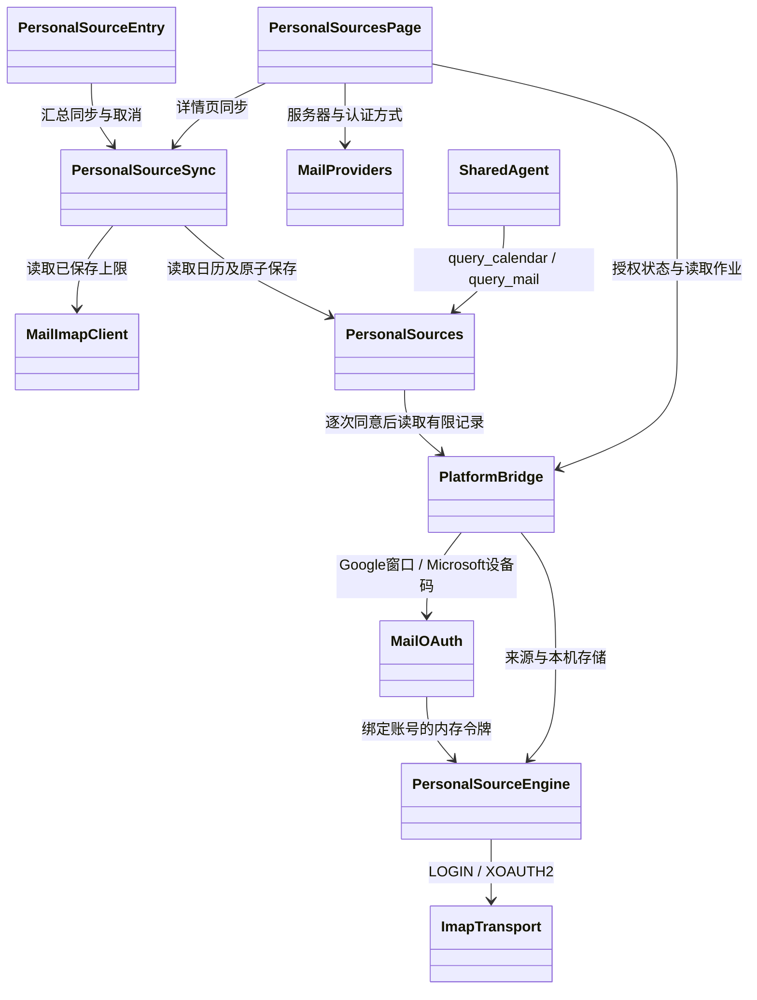

# 日历、邮箱与聊天问答接入

2026-11-03。用户已将日历/邮箱优先于原后续顺序，并要求覆盖主流邮箱。

## 源码与边界

邮件类型和MIME/IMAP解析复用鸿蒙 `4e86f6250c7739d0ea922e2379eeedad2d35d450` 的
`entry/src/main/ets/utils/mail/MailTypes.ets`、`MailImapCodec.ets`；MailImapClient保留原只读查询、
近三天、UIDVALIDITY、候选上限、正文选择与部分结果逻辑，仅把TLS连接替换为Android桥。
这些文件作为适配输入纳入Git；主上游锁不整体升级。
CalendarMemoryPolicy的历史/未来窗口、实例读取与安排非完成事实语义由CalendarContract适配。历史默认90天，现支持0/30/90/365天，未来固定30天。

入口：汇总→图库分析下方→日历分析 / 邮箱分析；也可从我的→数据采集的两个独立入口进入。Kotlin通用能力位于android-capabilities/platform/sources，
PlatformBridge仅接权限、作业和数据端口。页面使用ArkTS，保留Compose基线。

- 日历显式选来源、系统READ_CALENDAR授权、只读重复实例；权限撤回后不提供快照。
- 邮箱只读EXAMINE/BODY.PEEK、TLS主机名和系统证书验证；客户端凭据Keystore AES-GCM加密，
  不回传ArkTS。暂每次配置一个账号；保存配置清旧副本。邮件正文原样保存在私有目录、不进入画像。
- query_calendar/query_mail为独立工具，共享本轮3次工具预算；日期/关键词过滤、最多10项、正文500字，
  逐次确认当前模型，拒绝、撤权、取消不继续发送。返回同步时间、覆盖窗、部分/截断信息。
- 手动AI分析复用相同授权/有界数据。不会伪装为全量画像生成、后台同步、日历写回或邮件发送。
- 本阶段不包括鸿蒙日历完成标记、纳入画像开关、首页一周弹窗、邮件逐封关注偏好缓存；这些仍是完整功能对齐待办。

## 验证

首段完整ArkTS→APK构建通过。最终这一段APK SHA256：
`2d268cd4ad2555585669b4fe8a8f92ff24a3d30731a9b94aa5bffb6abce0a711`。
3项IMAP JVM检查通过；来源查询/模型工具回传受控检查通过；既有集成12项、源码/路由6项、原生桥7项通过。
连接手机已安装APK；PersonalSourcesDeviceTest 1项通过，使用隔离目录与合成凭据验证Keystore、
原子快照、清除及未授权分支，没有读取私人日历或登录真实邮箱。
手册生成与--check通过16章/7图，新增页暂无审核截图。

此前手动hvigor运行因工作目录、未设置环境变量失败；使用项目build.ps1成功。
instrumentation首次构建被来源摘要漂移正确拦截，重建共享前端后通过。
手册编辑遇系统Python编码、章ID及外链校验问题，改用可用Python与本地手册约定后通过。
未执行会议专项，构建脚本原有SDK打包完整性检查不属于会议功能测试。

待验收：真实日历实例/时区/重复例外、QQ/Gmail/交大及其他提供商、模型回答质量、页面无障碍与生命周期。
邮箱扩展与OAuth注册/接入见下节；不能把IMAP通用实现当作所有邮箱均已支持。

## 第二段：提供商预设与OAuth

注册及使用步骤见[MAIL_OAUTH_SETUP.md](MAIL_OAUTH_SETUP.md)。
新增QQ/Foxmail、网易163/126/yeah、腾讯/阿里企业邮箱、Gmail、Outlook/Hotmail/Microsoft 365、
iCloud、Yahoo、交大标准邮箱预设及自定义TLS。预设不能代表真实服务验收。

Google使用AuthorizationClient，绑定用户填写的Google账户及mail.google.com范围；
Microsoft使用公共客户端设备码流程和Exchange IMAP委托范围。用户码可展示，device_code/access_token
不返回ArkTS。取消使用代次隔离，晚到响应不能重新授权；设备码过期停止、pending间隔重试、
slow_down延长间隔。浏览器/系统授权窗口切换保留待授权流程，退出来源页取消。

XOAUTH2仅由原生专用方法发起，不放入普通桥命令白名单；认证错误challenge发空回复结束，
服务器原始认证详情不进入异常提示。OAuth只能使用固定Gmail/Outlook TLS端点，
防止用户修改服务器后把服务商令牌发到其他主机。凭据模式仍可配置自定义服务器。
两类OAuth令牌仅在进程内保存，不申请离线刷新令牌；重启/过期需要重新授权。
Google/微软授权范围可能比应用只读行为更广，页面与注册说明明确区分。

Google正式注册、Microsoft客户端ID/租户注册及逐提供商真实账号验收仍待用户侧完成；
没有将未注册状态、代码编译或合成响应测试标为真实服务成功。

### 第二段实际验证

- `shared-frontend/build.ps1 -JavaHome <local-jdk> -AndroidSdk <local-sdk> -MeetingSdkRoot <local-checkout> -Offline`
  完整通过；最终一次Gradle为1分29秒、93任务，APK SHA256
  `c35726eb82e57b1a214837114069a0b3623877561f213f8516d4b94e0b05779b`。
  原生包完整性、ELF及ZIP静态16KB检查通过，不代表真实16KB内核运行验收。
- `gradlew.bat :shared-app:assembleDebug :shared-app:assembleDebugAndroidTest :android-capabilities:testDebugUnitTest --tests com.clawmate.platform.sources.ImapTransportTest --offline --console=plain`
  通过；JUnit XML为5项、0失败/错误。测试APK构建通过。
- `verify-personal-sources.mjs`通过真实Kotlin桥签名参数数量、拒绝/取消/过期过滤及两种工具回传检查；
  `verify-integration.mjs`12项、`verify.mjs`6项、`verify-native.mjs`7项通过。
- 最终APK安装成功；`scripts/test-shared-device.ps1`默认普通回归8项通过，
  `am instrument`指定PersonalSourcesDeviceTest与MailOAuthDeviceTest共4项通过（最终0.43秒，完成码-1）。
  未运行会议专项。记录分别在忽略目录oauth-sources-final、oauth-device-final.log。
- 手动真机确认“我的→数据采集→日历与邮箱”可进入、默认配置/空副本正确读取、
  提供商选择与Microsoft表单可用；缺少注册参数明确提示补齐，未发起真实授权或读取私人日历/邮件。
- `python docs/user-manual/build.py`、`--check`通过16章/8张审核图；
  `node --test docs/user-manual/navigation.test.cjs`8项通过；新增空来源页截图与SHA/版本差异说明。

过程中首轮前端构建被来源摘要漂移拦截（编译时仍有页面变更），之后重建通过。
真机发现旧通用桥包装始终传两个参数，零/单参数方法失败；按真实签名修复并补回归。
另将OAuth参数异常转为结构化失败，避免ArkUI-X把原生校验异常笼统显示为Method not implemented。
两个问题均已在最终页面复核，不把之前的单纯VM成功当作完整UI验收。

## 官方服务依据

- [Gmail IMAP](https://developers.google.com/workspace/gmail/imap/imap-smtp)、[应用专用密码](https://support.google.com/accounts/answer/185833?hl=zh-Hans)
- [交大标准邮箱](https://net.sjtu.edu.cn/wlfw/dzyj.htm)：mail.sjtu.edu.cn:993；365邮箱是另一服务。
- [Microsoft OAuth IMAP](https://learn.microsoft.com/en-us/exchange/client-developer/legacy-protocols/how-to-authenticate-an-imap-pop-smtp-application-by-using-oauth/)
- [iCloud](https://support.apple.com/en-ie/102525)、[Yahoo](https://uk.help.yahoo.com/kb/SLN3697.html)

## 第三段：鸿蒙实机样式与来源设置（2026-11-04）

页面采用AppHeader/FrostedPage、白色分组卡片、常驻字段标签、行式蓝色操作和红色清除确认。
保留两个独立页面，不提供页内互跳。汇总PersonalSourceEntry位于图库下方，使用源码SVG图标，
分别进入页面/同步/取消。同步调用PersonalSourceSync，与详情页共享校验、读取和提交；
配置未准备好时禁用汇总同步按钮，失败或取消不更新成功快照。

PersonalSourceEngine的personal_source_options与邮箱凭据命名空间隔离；
日历启用、来源、0/30/90/365天范围保存后生效，关闭或修改范围/来源清除旧快照以阻止聊天读到过期选择。
仅枚举来源不读取事件。已有安装从本机快照推导原选择，不擅自勾选来源。
邮件上限20/50/100实际传给MailImapClient.maxMessages；退出/重进后保持，邮箱重授权或忘记账号不影响日历设置。

真机发现并修复重复生命周期初始化，以及ArkUI Builder按值参数冻结造成加载结束后按钮仍灰置；
动态操作、字段和说明采用$$引用绑定。OPPO实际检查刷新来源、Outlook预设切换和20封设置保存/重进，
验证后恢复50封。当前没有读取私人日历事件、登录真实邮箱或发送来源数据至模型。

检查：完整build.ps1构建、5项IMAP JVM、5项来源/OAuth真机、8项普通真机回归通过；
新增scripts/test-personal-source-sync.mjs使用真实邮件解析/读取器与合成IMAP响应验证上限、部分覆盖及取消不提交。
图文手册更新三张已审核OPPO截图；最终APK与命令记录见MIGRATION_STATUS.md。
画像、首页一周安排、邮件自动提醒/关注筛选与真实服务验收仍未完成。
